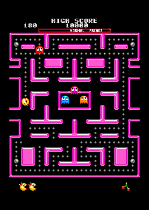

# Ms. Pac-Man (Tengen, Genesis) static recompilation

<p align="center">
  
</p>

Tengen's 1991 Genesis Ms. Pac-Man, recompiled to native code with
[segagenesisrecomp](https://github.com/mstan/segagenesisrecomp). The headline
feature is a **vertical full-maze view**: every maze type (Arcade, Mini, Big,
Strange) is shown in full, HUD included, with no forced scrolling. On top of
that: RetroArch shader presets through librashader, rewind, save states,
preemptive frames (one frame less input lag), fast forward, pause and frame
advance, rebindable shortcuts, and the recomp-ui launcher and in-game menu.

## Download

Builds for Windows (x64, x86, ARM64) and Linux (x86_64, aarch64; a tarball or
an AppImage) are on the
[Releases](https://github.com/vibecodekun/mspacmanrecomp/releases/latest) page.
Extract one and run `MsPacManRecomp.exe` / `MsPacManRecomp`; the launcher asks
for the ROM on the first start.

**No ROM is included.** You need your own Ms. Pac-Man (USA, Europe) Genesis ROM,
the No-Intro dump `Ms. Pac-Man (USA, Europe).md`: SHA-256
`87f3c75fea5c4e105163a3b6d4467527fdc3fcc4b8e385155067719b98b2be7c` (CRC32
`AF041BE6`). The launcher reads "ROM verified" under the box art and enables
PLAY only for that file; any other file reads "ROM not recognized" and does
not start. The code was recompiled from that exact ROM.

## Layout

| Path | What |
|---|---|
| `CMakeLists.txt` | Game build (recompiler → generated C → `MsPacManRecomp`) |
| `segagenesisrecomp/` | Recompiler and runtime (submodule: [fork](https://github.com/vibecodekun/segagenesisrecomp/tree/mspacman) of [mstan/segagenesisrecomp](https://github.com/mstan/segagenesisrecomp), branch `mspacman`); the GL frontend is `runner/frontend/` |
| `recomp-ui/` | Launcher and in-game menu (submodule: [fork](https://github.com/vibecodekun/recomp-ui/tree/shantae) of [RetroPortingToolKit/recomp-ui](https://github.com/RetroPortingToolKit/recomp-ui), branch `shantae`) |
| `game/game.toml` | Recompiler config for this ROM |
| `game/mspacman_spec.c` | Game hooks: interrupt model and save-state resume points (see below) |
| `game/mspacman_video.c` | Full-maze view renderer |
| `game/mspacman.bin` | The ROM: you supply it; never committed |
| `assets/boxart.tga` | Launcher box art (cut from the title screen) |
| `cmake/default_settings.cmake` | First-run `settings.ini` in a build dir (full-maze view on) |
| `release/settings.ini` | The same defaults, shipped in every release |
| `tools/check_startup.py` | 600 frames through the game loop and the GL frontend in a hidden window: no interpreter fallback, no dispatch miss |
| `tools/check_states.py` | Preemptive frames against none, and a save state loaded by another process, compared by machine-state hash |
| `tools/build_librashader.sh` | Build `librashader.dll` (OpenGL runtime; x64, or x86/arm64 when named) and stage the slang-shaders presets |
| `third_party/librashader/` | Its output: the x64 DLL, `windows-<arch>/librashader.dll`, `shaders/`, and `patches/` applied to the librashader source; `linux-<arch>/librashader.so` from `tools/build_linux.sh` |
| `tools/build_windows.sh`, `tools/windows/` | Windows releases for x64, x86 and ARM64 (below): pinned msys2 libraries, CMake toolchain, DLL staging, packaging, checks |
| `third_party/windows/` | The pinned msys2 packages and the x86/ARM64 sysroots unpacked from them (`tools/windows/bootstrap.sh`) |
| `tools/build_linux.sh`, `tools/linux/` | Linux releases for x86_64 and aarch64 (below): toolchain bootstrap, CMake toolchain, packaging, checks |
| `LICENSE`, `THIRD-PARTY-LICENSES.md` | This project's license (PolyForm Noncommercial 1.0.0) and the components the releases carry |

## Build and run

The recompiler and the Windows build run on Windows with
[MSYS2](https://www.msys2.org) installed at `C:\msys64`, plus Git and Python
3.11+:

```bash
pacman -S mingw-w64-x86_64-gcc mingw-w64-x86_64-cmake mingw-w64-x86_64-ninja mingw-w64-x86_64-SDL2 mingw-w64-x86_64-angleproject
```

```bash
git clone --recursive https://github.com/vibecodekun/mspacmanrecomp.git
cd mspacmanrecomp
cp "/path/to/Ms. Pac-Man (USA, Europe).md" game/mspacman.bin
bash tools/build_windows.sh x64 --no-package   # recompiler -> build/x64/generated/mspac -> build/x64/MsPacManRecomp.exe
```

Already cloned without `--recursive`? Run `git submodule update --init --recursive`.

The generated 68000 translation is built at `-O1` (it is large and flat), the
runtime and the game adapter, which run every scanline, at `-O2`. Generated C
lives only in `build/x64/generated/mspac/` and is regenerated whenever the ROM,
`game/game.toml` or the recompiler changes. `build_windows.sh` builds
`librashader.dll` first (Rust needed; `--no-librashader` skips it, and the game
then runs without shader presets).

Run `build/x64/MsPacManRecomp.exe`. The launcher has controller setup (3/6-button,
keyboard or pad, rebinding), Settings, and **Mods → Full maze view** (on/off,
and Canvas: *All mazes* = one 360-line canvas, *Per maze* = height follows each
maze). Tick "Skip launcher on boot" to go straight into the game next time.
Passing a ROM path skips the launcher and allows overrides:
`--widescreen off` (original scrolling view), `--widescreen fit`,
`--widescreen stage`.

Only the ROM the build was recompiled from starts: the launcher checks its
SHA-256 (the line under the box art and the PLAY button follow it), and the
runtime checks size, CRC32 and SHA-256 again at boot, which is what stops a
wrong ROM when "Skip launcher on boot" is on (a "Wrong ROM" box, then the
launcher).

## Full-maze view

Full-view heights: Mini 264, Strange 304–312, Arcade 312, Big 360 lines
(native is 224). Title, menus and intermissions are shown at native size.

The game draws each whole maze into a 256×512 plane when the maze loads, and
all scrolling is one camera word (`$FF000E`) copied to VSRAM each V-blank.
Sprites are kept in screen space and re-based by the game when the camera
moves. So the renderer locks the camera at the top of the playfield, draws
the planes from VRAM, and shifts each sprite by `game camera − locked camera`.
Game logic is untouched. The view verifies itself every frame: the 224 rows
the hardware raster produced must reappear unchanged in the tall frame (TCP
command `mspac_view`, see below). Shader presets get the tall frame too.

## The frontend

The game presents through the runtime's GL frontend
(`segagenesisrecomp/runner/frontend/`), a port of the one in the
[Shantae recomp](https://github.com/vibecodekun/shantaerecomp): OpenGL ES 3.1
through ANGLE (over Direct3D 11) on Windows and the system's OpenGL on Linux.
A PC whose driver has no OpenGL ES gets the engine's plain SDL picture and
the overlay menu instead.

- **Esc**, or a controller's Guide/Home button, opens the in-game menu:
  settings, the full-maze view, shader presets, save states, Restart Game,
  Return to Launcher and Quit. **F10** opens the full settings window.
- **Shortcuts** (all rebindable in the settings window, Advanced → Controls):
  Tab hold fast forward, `` ` `` fast forward on/off, R hold rewind, F5/F8
  save/load state, F6/F7 state slot, P pause, O advance one frame, F1 overlay,
  F9 mute, F11 fullscreen. On a controller, the right trigger fast forwards
  and the left one rewinds. Settings are saved in `runtime_prefs.ini`.
- **Rewind** keeps compressed snapshots (differences against the previous one)
  in a buffer of 16 MB and up; its size, and how many frames apart the
  snapshots are, are in the settings window's Advanced → Display.
- **Preemptive Frames** (1 by default, Advanced → Display) is RetroArch's
  preemptive frames (`runahead.c`, `preempt_run`): a ring
  keeps the state from before each of the last N frames; when the input
  changes, the oldest is loaded and those frames run again with the new input,
  silently, before the next frame is shown. The game sees each press N frames
  sooner and is otherwise unchanged; `tools/check_states.py` checks that a
  press a frame late with one preemptive frame plays exactly as a press on
  time.
- **Save states** (`MSPAC.state1`…, beside the game) can be made during play,
  not on the title or demo screens: see the interrupt model below for why. A
  state file holds the whole machine, the game's fiber included, as the runtime's
  rollback snapshot, so it loads in any later run of the same build.
  `tools/check_states.py` saves one, loads it in another process and compares
  the machine state 600 frames later.
- Fast forward has its own speeds and frame skip for the hold and the toggle,
  with sound sped up, muted or left at normal pitch.

### Shader presets (librashader)

RetroArch `.slangp` presets (CRT, LCD, scalers, Mega Bezel...) run through
[librashader](https://github.com/SnowflakePowered/librashader). Set it up once:

```bash
bash tools/build_librashader.sh     # needs Rust (cargo); ~2 min the first time
```

The script clones librashader 0.12.0 into `third_party/librashader/checkout`
the first time (`LIBRASHADER_SRC` points it at a checkout of your own instead),
exports that checkout without modifying it, applies
`third_party/librashader/patches/`, builds the OpenGL runtime only, and copies
the checkout's slang-shaders collection. The build then stages `librashader.dll`
and `shaders/` next to `MsPacManRecomp.exe`. Without them the game runs as
before. The DLL links the C and C++ runtimes in (`crt-static`), so players need
no Visual C++ Redistributable.

In game: **Esc → Shader presets**, or the settings window's **Shader Presets
(librashader)** section. Pick a preset (the filter box takes words such as
`crt` or `geom`), tune its parameters, and **Reset All** to go back. **Edit
Preset** changes how a preset is set up, the way RetroArch's Shader menu does
(passes, filters, scales, formats; **Save Preset** writes
`shader_presets/<name>.slangp`). A preset that has not loaded before is first
compiled in a hidden child process while the game keeps running, so one that
crashes the driver's compiler cannot take the game down; compiled programs are
cached in `shader_cache/`. `GENESIS_SHADER_PRESET` overrides the preset for one
run.

`third_party/librashader/patches/` makes librashader's GLSL ES output work
under ANGLE:

| Patch | Fixes |
|-------|-------|
| 0001 | History copies used a blit ANGLE rejects; presets reading previous frames read black |
| 0002 | Integer varyings need `flat` on the vertex side in GLSL ES (crt-yah, ntsc-blastem) |
| 0003 | ANGLE's D3D translator cannot write global arrays-of-arrays constants; they are assigned in `main()` instead (crt-hyllian, crt-sony-megatron, crt-nobody, dithering) |
| 0004 | Quoted preset values end at the closing quote, as in RetroArch (`"../..//x"`, `"true""`) |
| 0005 | RelaxedPrecision is dropped, working around a SPIRV-Cross GLSL ES bug (simple-crt) |

## Windows (x64, x86 and ARM64)

```bash
bash tools/build_windows.sh         # all three -> dist/windows/ (or name x64, x86, arm64)
bash tools/windows/check.sh         # imports, startup and state checks
```

- **x64** builds in `build/x64` with msys2's mingw64 GCC and runs the
  recompiler; the other two compile its generated C
  (`GENESIS_PREGENERATED_DIR`), so they need neither the recompiler for their
  arch nor the ROM.
- **x86** (32-bit) builds in `build/x86` with msys2's mingw32 GCC
  (`pacman -S mingw-w64-i686-gcc`).
- **ARM64** builds in `build/arm64` with mingw64's clang and lld
  cross-compiling to `aarch64-w64-mingw32` against msys2's clangarm64 runtime
  (libc++, compiler-rt, UCRT).
- The game fiber's context switch (minicoro) had none for 32-bit Windows or
  Windows on ARM; this build adds both, keeping the thread information block's
  stack bounds, SEH chain and fiber data per fiber as minicoro's Win64 switch
  does (`runner/external/minicoro/minicoro.h`).
- SDL2, ANGLE and the ARM64 runtime come from msys2 packages pinned by SHA-256
  in `tools/windows/bootstrap.sh`, unpacked into `third_party/windows/`
  (`$MSPAC_WINDOWS_CACHE`, no spaces); nothing is installed into msys2.
- `librashader.dll` is `tools/build_librashader.sh <arch>`'s, through Rust's
  MSVC targets (Visual Studio's x86 and ARM64 C++ tools).
- `tools/windows/dlls.sh` follows the imports of the exe and of
  `librashader.dll`: each build dir gets the DLLs it needs beside the exe, the
  zip carries exactly those, and the build fails if one is missing or is
  another arch's.
- `dist/windows/mspacman-recomp-<version>-windows-<arch>.zip` is a folder with
  `MsPacManRecomp.exe`, its DLLs, `assets/`, `shaders/`, the default
  `settings.ini` and `tools/windows/README-windows.txt`. Packaging is an
  allowlist and refuses anything that looks like a ROM, a state or a
  `rom.cfg`. `<version>` is `$MSPAC_VERSION`, or the project version.
- `tools/windows/check.sh` checks every build with
  `tools/windows/check_imports.py` (each module is the arch's, and every
  function imported from a DLL beside the exe is exported by it), then runs
  `tools/check_startup.py` (through ANGLE, and again on SDL's dummy driver for
  the no-GL fallback) and `tools/check_states.py` on each build this PC can
  run: x64 and x86 on an x64 PC; ARM64 needs an ARM64 PC.

## Linux (x86_64 and aarch64)

`tools/build_linux.sh` builds the Linux releases from the x64 build's generated
C, in WSL (Ubuntu) or on any Debian/Ubuntu machine:

```bash
wsl bash tools/build_linux.sh       # both arches -> dist/linux/ (x86_64 or aarch64 for one)
wsl bash tools/linux/check.sh       # startup and state checks
```

The first run fetches its toolchain into `~/.cache/mspacman-linux`
(`tools/linux/bootstrap.sh`, `$MSPAC_LINUX_CACHE` moves it; nothing needs
root): Zig as the C/C++ cross compiler, CMake and Ninja, each arch's Ubuntu
24.04 X11/Wayland/audio/GL headers and libraries through an unprivileged apt,
SDL2 built static, Rust and cargo-zigbuild for librashader, Debian 10's
libraries for the checks, and appimagetool. The toolchain is the Shantae
recomp's, so the two can share one cache.

- The binaries target **glibc 2.28** (Zig's glibc stubs), so they run on Debian
  10+, Ubuntu 20.04+, RHEL 8+, Fedora, Arch, SteamOS, Raspberry Pi OS 64-bit
  and so on. SDL2 and the C++ runtime (libc++) are linked in; at start they
  load only glibc and `libGL.so.1`. X11, Wayland (with libdecor), KMSDRM,
  PipeWire, PulseAudio, ALSA, udev and D-Bus are opened at run time when the
  system has them. `build_linux.sh` fails a binary that needs a newer glibc
  symbol.
- `librashader.so` is built from `third_party/librashader/src` with
  cargo-zigbuild into `third_party/librashader/linux-<arch>/`, and the game
  finds it beside itself through its RUNPATH (`$ORIGIN`).
- `dist/linux/mspacman-recomp-<version>-linux-<arch>.tar.gz` is a folder that
  runs from anywhere writable and keeps its state inside it;
  `MsPacMan_Recomp-<version>-<arch>.AppImage` keeps its state beside the
  .AppImage. The tarball carries `tools/linux/README-linux.txt`.
- `tools/linux/check.sh` runs `tools/check_startup.py` and
  `tools/check_states.py` on the host, and the startup check again on Debian
  10's glibc 2.28 (aarch64 through qemu-user).

## Interrupt model

All gameplay runs inside the V-blank interrupt. The main program only unmasks
interrupts in two `BRA *` idle loops (`$0008F6`, `$00F76E`), and the handler
can run for many frames or discard its own exception frame and continue as
main-program code. `game/mspacman_spec.c` therefore takes IRQ6 on the game
fiber from those idle loops (see the comment at the top of that file).

This decides where a save state can be taken. A state file must be loadable
by a later run, so it cannot hold the fiber's native stack; it is only written
when the fiber is parked in the driver's idle wait, where the machine state
alone says how to resume. During play the V-blank handler can run across a
frame boundary, so a save holds the next interrupt until the tick ends. The
title and demo screens run as main-program code that never returns to that
wait, so states are refused there with a message (rewind and preemptive frames
keep the fiber in memory and work everywhere).

## Sound

The Z80 sound driver times its music off the YM2612's **Timer A** (it polls
the status flag at Z80 `$014D`). The runner's synchronous YM status model
originally implemented only Timer B, so the driver never ticked and the game
was silent; Timer A now lives beside it in `runner/video/genesis_bus.c`.

## Debugging

Dev builds include the TCP debug server (`GEN_ENABLE_TRACE`, on by default;
the release scripts turn it off):

```bash
cmake -G Ninja -S . -B build/dev && ninja -C build/dev
```

Put a `debug.ini` containing `port=4382` next to the exe to enable it, then
e.g.:

```bat
python segagenesisrecomp\tools\tcp_cmd.py 4382 "{\"id\":1,\"cmd\":\"mspac_view\"}"
```

After every run, `dispatch_misses.toml` next to the exe should list no
functions (`tools/check_startup.py` fails on any).

## License

This project's own code is licensed under the
[PolyForm Noncommercial License 1.0.0](LICENSE), the same as the
segagenesisrecomp engine. The submodules and the libraries the releases carry
keep their own licenses; see [THIRD-PARTY-LICENSES.md](THIRD-PARTY-LICENSES.md).

Ms. Pac-Man is a trademark of Bandai Namco Entertainment. This project
contains no ROM; the box art and screenshot are captures of the game running.
It is not affiliated with or endorsed by Bandai Namco, Tengen, or Sega.
